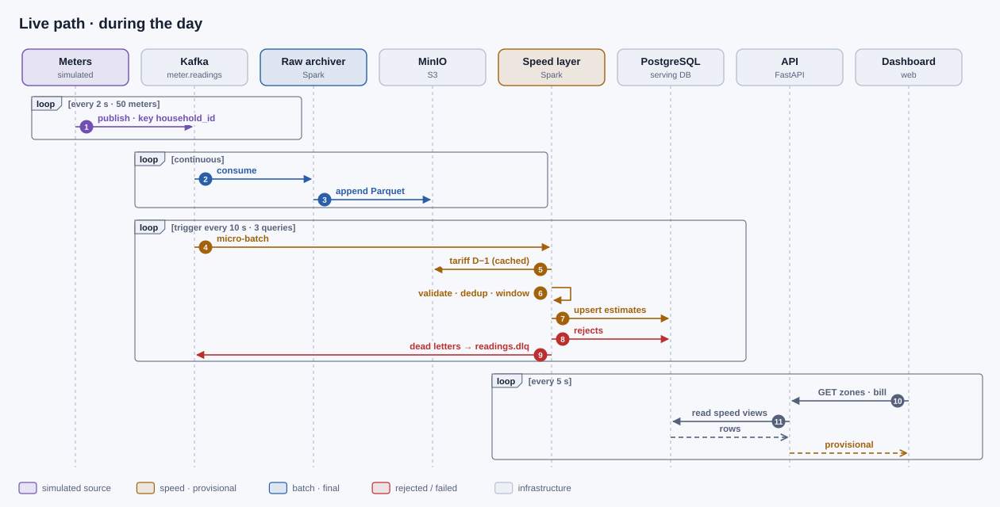
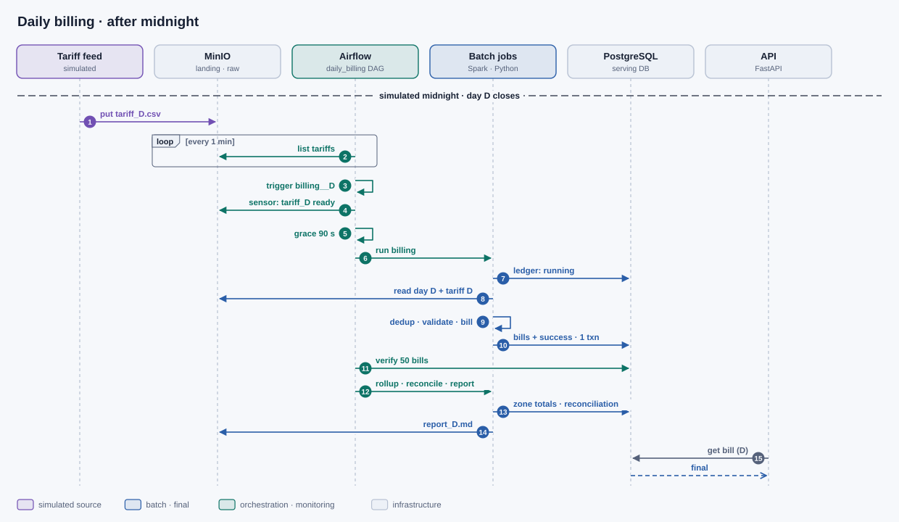
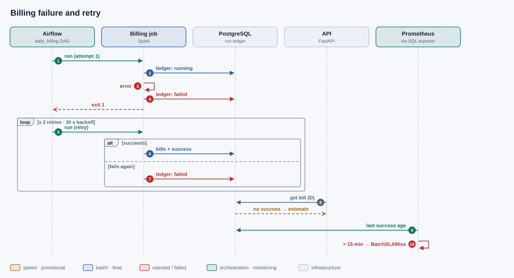
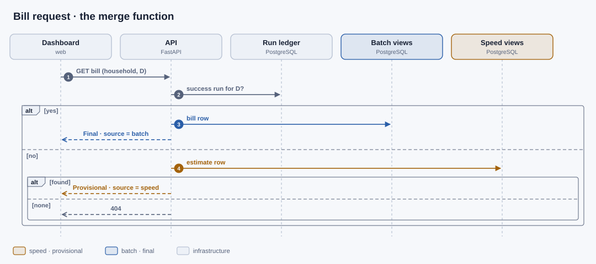
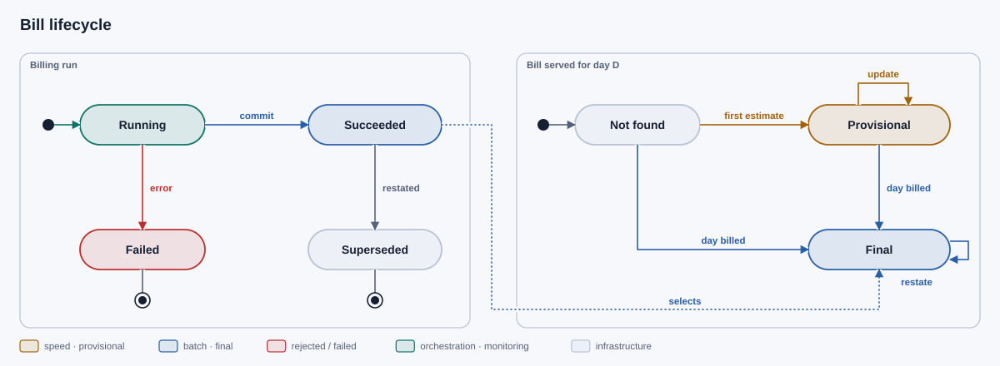
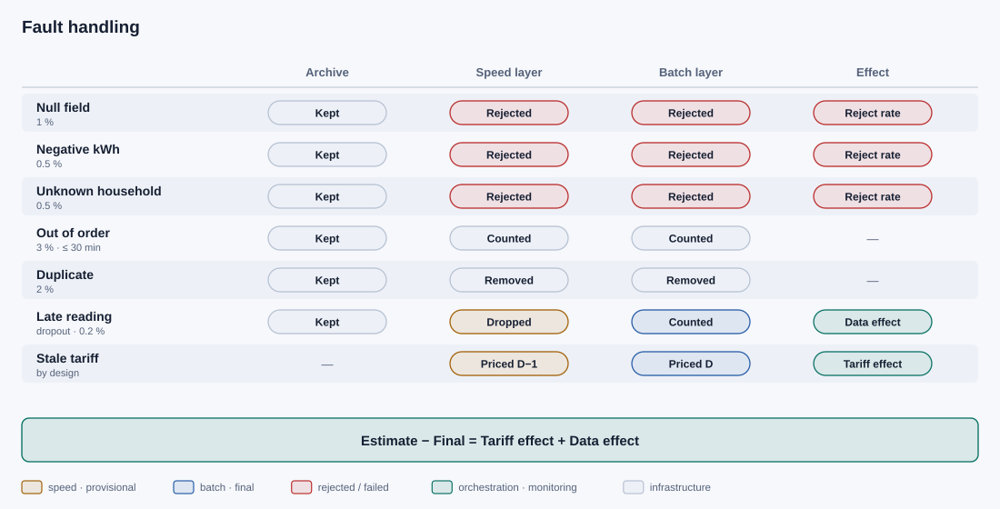
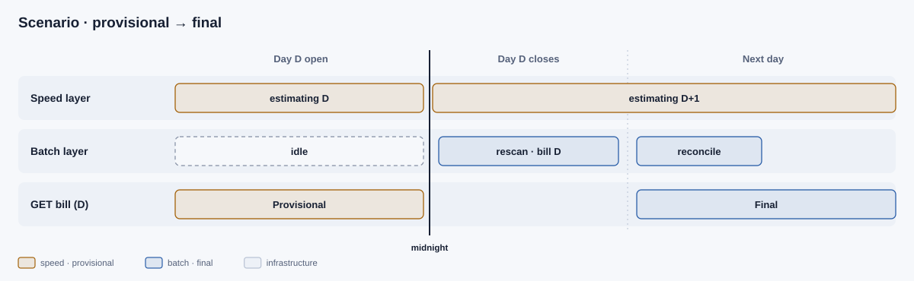

# ⚡ Voltstream

[](https://github.com/Malee-Fonseka/voltstream/actions/workflows/ci.yml)


**Real-time grid monitoring and exact daily billing from one smart-meter stream.**
A Lambda-architecture data platform built for _Smart Grid Energy Monitoring & Billing_.


<table>
<tr>
<td width="33%"><b>⚡ Live in seconds</b><br>Grid load and solar share per zone, about 6 s behind the meters.</td>
<td width="33%"><b>🧾 Exact bills, daily</b><br>The batch layer re-bills each closed day from the raw data with that day's tariff.</td>
<td width="33%"><b>🔔 Watched end to end</b><br>JSON logs, 10 metrics, 5 alert rules and 3 Grafana dashboards.</td>
</tr>
</table>

## Contents

1. [Architecture](#1-architecture)
2. [Quick start](#2-quick-start)
3. [The dashboard](#3-the-dashboard)
4. [Reproduce the results](#4-reproduce-the-results)
5. [Run the tests](#5-run-the-tests)
6. [Troubleshooting](#6-troubleshooting)
7. [Reference](#7-reference)

---

## 1. Architecture

Fifty simulated homes report their electricity use and rooftop solar every 2 seconds, and
the electricity prices for each day arrive once that day is over. Two users need very
different things from the same data:

- **Grid operators** want to know the load and solar share in each zone **right now**. An
  approximate answer in seconds is worth more than a perfect one tomorrow.
- **Billing** needs an **exact** bill for every home, for every day. That is only possible
  once the day is over and its prices and every late reading have arrived.

Voltstream serves both from one stream of readings, using a **Lambda architecture**: a fast
path for "now", a slow path for "exact", and one API that always gives the best answer
available.

<p align="center">
  <picture>
    <source media="(prefers-color-scheme: dark)" srcset="docs/architecture/diagrams/00-overview-dark.svg">
    
  </picture>
</p>

- **Speed layer: fast, approximate.** It adds up readings within seconds. Because today's
  prices don't exist yet, it uses yesterday's, and it skips readings that arrive very late.
  Its bills are **estimates**.
- **Raw archive: nothing is lost.** Every reading is stored exactly as it arrived.
- **Batch layer: slow, exact.** When a day ends and its prices arrive, it re-reads the whole
  day from the archive and calculates the **final bill**.
- **One answer.** The API returns the final bill once it exists, and the estimate until then,
  and always says which one it is. On the dashboard a bill's badge flips from
  **Provisional** to **Final**.

Both layers use the same billing code, so an estimate and its final bill can differ for only
two reasons: different prices (the _tariff effect_) and late readings (the _data effect_).
The system measures both, every day.

**Time runs fast:** one simulated day lasts **5 real minutes**, starting at 2026-01-01 00:00
when you start the stack.

### The components

Each box is a running service, each cylinder a data store and each pipe a Kafka topic.
Colours show which layer owns what: **amber** for the speed layer, **blue** for the batch
layer, **red** for rejected data.

<p align="center">
  <picture>
    <source media="(prefers-color-scheme: dark)" srcset="docs/architecture/diagrams/01-data-flow-dark.svg">
    
  </picture>
</p>

### Going deeper

The diagrams below are optional: click to expand.

<details>
<summary><b>A day, step by step</b> (live readings, nightly billing, a failed run)</summary>

**During the day.** Readings from the same home always go to the same Kafka partition, so
they stay in order. The archiver and the speed layer read the stream separately, so if one
of them stops, the other carries on.

<p align="center">
  <picture>
    <source media="(prefers-color-scheme: dark)" srcset="docs/architecture/diagrams/02a-live-path-dark.svg">
    
  </picture>
</p>

**After midnight.** The arrival of a day's price file means the day is over. Airflow waits
90 seconds for any late readings, then bills the whole day in a single database
transaction, so a day is billed completely or not at all.

<p align="center">
  <picture>
    <source media="(prefers-color-scheme: dark)" srcset="docs/architecture/diagrams/02b-daily-billing-dark.svg">
    
  </picture>
</p>

**When billing fails.** A failed run leaves nothing half-written, so Airflow simply tries
again. Meanwhile customers keep seeing the estimate. If no run succeeds for 15 minutes, an
alert fires.

<p align="center">
  <picture>
    <source media="(prefers-color-scheme: dark)" srcset="docs/architecture/diagrams/02c-billing-failure-dark.svg">
    
  </picture>
</p>

</details>

<details>
<summary><b>How a bill goes from Provisional to Final</b></summary>

Every billing run is recorded in a run ledger. When someone asks for a bill, the API checks
one thing: has a run for that day succeeded? If so, it returns the final bill; if not, the
estimate.

<p align="center">
  <picture>
    <source media="(prefers-color-scheme: dark)" srcset="docs/architecture/diagrams/02d-bill-request-dark.svg">
    
  </picture>
</p>

A final bill never goes back to provisional. Re-running a day replaces the old bills in the
same transaction, and the old run is kept, marked as superseded.

<p align="center">
  <picture>
    <source media="(prefers-color-scheme: dark)" srcset="docs/architecture/diagrams/03-bill-states-dark.svg">
    
  </picture>
</p>

</details>

<details>
<summary><b>Bad, duplicate and late readings</b></summary>

To prove the pipeline copes with messy data, the simulator injects faults on purpose. The
archive keeps everything; each layer then decides what to do with it. Two differences
remain between the layers, and they add up exactly to the gap between estimate and final.

<p align="center">
  <picture>
    <source media="(prefers-color-scheme: dark)" srcset="docs/architecture/diagrams/04-fault-handling-dark.svg">
    
  </picture>
</p>

</details>

<details>
<summary><b>Deployment</b></summary>

All 18 containers run under Docker Compose and start in four tiers; each tier waits until the
one before it is healthy.

<p align="center">
  
</p>

</details>

---

## 2. Quick start

**You need:** Docker Desktop with **at least 8 GB memory (10 GB recommended)** and 4+
CPUs, and Git (Git Bash on Windows). Ports 3000, 5432, 8000, 8011, 8012, 8080, 9000, 9001,
9090, 9091, 9093 and 29092 must be free.

```powershell
git clone https://github.com/Malee-Fonseka/voltstream.git
cd voltstream
.\scripts\voltstream.ps1 run        # Linux / WSL: make up
```

This builds the images, starts all 18 containers and waits for their health checks (first
build: several minutes; later starts: about a minute). `.env` is created from
`.env.example` automatically; nothing needs editing.

| What                      | URL                                                 | Login                                                          |
| ------------------------- | --------------------------------------------------- | -------------------------------------------------------------- |
| **Dashboard**             | <http://localhost:8000/>                            | none                                                           |
| API reference (OpenAPI)   | <http://localhost:8000/docs>                        | none                                                           |
| Grafana                   | <http://localhost:3000/>                            | none                                                           |
| Airflow                   | <http://localhost:8080/>                            | `admin`; password printed by `.\scripts\voltstream.ps1 status` |
| Prometheus / Alertmanager | <http://localhost:9090/> / <http://localhost:9093/> | none                                                           |
| MinIO console             | <http://localhost:9001/>                            | `voltstream` / `voltstream-dev`                                |

**What to expect:** live zone data within 20 s; day 1 billed about 8 minutes after start;
**day 2 (2026-01-02), the first complete day, billed and reconciled after about 13
minutes**. Then run `.\scripts\voltstream.ps1 check`; it should end with **0 failed**.
`LowRenewableContribution` firing every simulated night is expected (no sun).

| Windows                          | Linux / WSL                                                                | Effect                     |
| -------------------------------- | -------------------------------------------------------------------------- | -------------------------- |
| `.\scripts\voltstream.ps1 stop`  | `make down`                                                                | Stop, keep data            |
| `.\scripts\voltstream.ps1 start` | `docker compose --env-file .env -f docker/docker-compose.yml up -d --wait` | Resume on the same clock   |
| `.\scripts\voltstream.ps1 clean` | `make clean`                                                               | Delete containers and data |

<details>
<summary>Windows tips: giving Docker more memory, script permissions</summary>

Docker Desktop gets half the machine's RAM by default. For 10 GB, create
`C:\Users\<you>\.wslconfig` with:

```ini
[wsl2]
memory=10GB
```

then run `wsl --shutdown` and restart Docker Desktop. If PowerShell refuses to run the
script: `Set-ExecutionPolicy -Scope CurrentUser RemoteSigned`.

</details>

---

## 3. The dashboard

<http://localhost:8000/> refreshes every 5 seconds. Amber means speed layer / provisional,
teal means batch layer / final. Every chart has a table view (▦).

- **Live grid** (top of this page): load, solar, renewable share, active meters and
  speed-layer lag per zone, from 15-minute windows. Click a zone to focus on it.
- **Household bills**: one household's bill for one day, from whichever layer can answer,
  with the bill breakdown, energy flow, block tariff, estimate vs final and lineage.

| While the day is open: **Provisional (speed)**                          | After billing: **Final (batch)**                            |
| ----------------------------------------------------------------------- | ----------------------------------------------------------- |
|  |  |

- **Daily report**: everything known about one day: zone totals, rejected records by
  reason, speed-vs-batch divergence and every billing run.


- **How it works**: an animated pipeline diagram and a guided tour of one reading.

---

## 4. Reproduce the results

Each script runs unattended and **undoes its own changes**, even on Ctrl+C. Let at least one
day be billed first (about 8 minutes after start).

| Scenario              | Windows (`.\scripts\voltstream.ps1 …`)                                 | Linux                        | Shows                                                      | Time     |
| --------------------- | ---------------------------------------------------------------------- | ---------------------------- | ---------------------------------------------------------- | -------- |
| Provisional → final   | `demo`                                                                 | `make demo`                  | The merge function flipping a bill from speed to batch     | ~7 min   |
| All five alerts       | `faults`                                                               | `make faults`                | Each alert fires under its fault, then clears              | ~30 min  |
| One alert             | `faults -Scenario stale` (`rejects`, `sla`, `renewable`, `divergence`) | `make faults s=stale`        | A single alert                                             | 3–17 min |
| Crash the speed layer | `killtest`                                                             | `make kill-test`             | Losing the speed layer costs freshness, never correctness  | 7–10 min |
| Restate a day         | `backfill -Date 2026-01-02`                                            | `make backfill d=2026-01-02` | A corrupted tariff fixed by recomputing, with history kept | 6–8 min  |

### What each scenario shows

**Provisional → final** (`demo`). Asks for the same home's bill twice: while the day is
still open, and again after it has been billed.

<p align="center">
  <picture>
    <source media="(prefers-color-scheme: dark)" srcset="docs/architecture/diagrams/06-scenario-demo-dark.svg">
    
  </picture>
</p>

**Crash the speed layer** (`killtest`). Stops the speed layer for a minute. The live view
freezes, but nothing is lost: the archive keeps recording, and the day is still billed in
full. ✓ marks what the script checks.

<p align="center">
  <picture>
    <source media="(prefers-color-scheme: dark)" srcset="docs/architecture/diagrams/07-scenario-kill-dark.svg">
    
  </picture>
</p>

**Restate a day** (`backfill`). Bills a past day again with a deliberately wrong price file,
then once more with the correct one. Each run replaces the bills customers see, while every
earlier version is kept in the history.

<p align="center">
  <picture>
    <source media="(prefers-color-scheme: dark)" srcset="docs/architecture/diagrams/08-scenario-restate-dark.svg">
    
  </picture>
</p>

**Alert drills** (`faults`). Each drill breaks one thing, waits for its alert, then puts
things back. The bars show how long each takes.

<p align="center">
  <picture>
    <source media="(prefers-color-scheme: dark)" srcset="docs/architecture/diagrams/09-scenario-drills-dark.svg">
    
  </picture>
</p>

### Monitoring and alerts

Prometheus collects metrics from every service and checks five alert rules. Alertmanager
sends the alerts to the API, which logs them; no email or pager is set up.

<p align="center">
  <picture>
    <source media="(prefers-color-scheme: dark)" srcset="docs/architecture/diagrams/05-alerting-dark.svg">
    
  </picture>
</p>

| Alert                                | Fault                       | Fires after               |
| ------------------------------------ | --------------------------- | ------------------------- |
| `MeterDataStale` (critical)          | Meter producer stopped      | ~3 min                    |
| `HighRejectRate` (warning)           | 15% of readings invalid     | ~2 min                    |
| `BatchSLAMiss` (critical)            | Billing DAG paused          | 15 min after last billing |
| `LowRenewableContribution` (warning) | None: every simulated night | at dusk                   |
| `LambdaDivergenceHigh` (warning)     | 60% of readings very late   | 8–13 min (needs ~10 GB)   |

| Grafana: pipeline health                                                 | Prometheus: the five rules                                             |
| ------------------------------------------------------------------------ | ---------------------------------------------------------------------- |
|  |  |
| **Alertmanager**                                                         | **Grafana: Lambda divergence**                                         |
|                |  |

The nightly billing in Airflow, with all eight steps green:


### Try the API

Every response says which layer answered (`"source": "speed"` or `"batch"`). Full reference
at <http://localhost:8000/docs>; in PowerShell use `curl.exe`.

```bash
curl -s localhost:8000/api/v1/zones/load                                  # latest window per zone
curl -s "localhost:8000/api/v1/households/HH-0001/bill?date=2026-01-02"   # merged bill: see "source"
curl -s "localhost:8000/api/v1/reports/daily?date=2026-01-02"             # the daily report
```

---

## 5. Run the tests

Needs Python 3.11 and Java 17, not Docker:

```bash
python -m venv .venv                                   # Windows: py -3.11 -m venv .venv
.venv/bin/pip install -e ".[dev,api,sim,spark]"        # Windows: .venv\Scripts\pip ...
make test                                              # unit, property and consistency tests
```

`make coverage` adds CI's gate (`core/` at 100%), `make lint` runs ruff and mypy,
`make check-alerts` tests the alert rules with promtool, and `make test-all` adds the
integration tests (needs the stack running). CI runs lint, tests and alert checks on every
push.

---

## 6. Troubleshooting

| Symptom                                        | Fix                                                                                                   |
| ---------------------------------------------- | ----------------------------------------------------------------------------------------------------- |
| Start times out / a service is unhealthy       | `.\scripts\voltstream.ps1 status`, then `logs -Service <name>`. Usually Docker has too little memory  |
| Simulated dates far in the future              | The clock anchor in `.env` is stale: `clean`, then `run`. Never start with a bare `docker compose up` |
| After the laptop sleeps, `BatchSLAMiss` fires  | Expected (hours asleep are weeks simulated); clears after the next billing run                        |
| `check` fails during a billing run             | The laptop was briefly overloaded; re-run a minute later                                              |
| An alert in Grafana is missing in Alertmanager | It is inhibited by another alert; tick _Inhibited_                                                    |

---

## 7. Reference

| Service                                                                | Port                      | Role                                                                    |
| ---------------------------------------------------------------------- | ------------------------- | ----------------------------------------------------------------------- |
| `kafka`                                                                | 29092                     | Event log, 3 partitions, ~7 day retention                               |
| `postgres`                                                             | 5432                      | Serving layer: speed and batch views                                    |
| `minio`                                                                | 9000 / 9001               | Master dataset and landing zone (`pgsty/silo`, a MinIO-compatible fork) |
| `meter-producer`, `reference-dropper`                                  | —                         | The two simulated sources                                               |
| `raw-archiver`, `speed-layer`                                          | 8011, 8012                | Kafka → Parquet; live windows and provisional bills                     |
| `api`                                                                  | 8000                      | Serving API, merge function, dashboard                                  |
| `airflow` (+ `docker-socket-proxy`)                                    | 8080                      | Bills each day as its tariff lands                                      |
| `prometheus`, `alertmanager`, `pushgateway`, `sql-exporter`, `grafana` | 9090, 9093, 9091, —, 3000 | Monitoring and alerting                                                 |

| Looking for                                 | Start here                                                                                                            |
| ------------------------------------------- | --------------------------------------------------------------------------------------------------------------------- |
| Shared billing logic / layer agreement test | [src/voltstream/core/](src/voltstream/core/), [test_pure_vs_spark.py](tests/consistency/test_pure_vs_spark.py)        |
| Sources and ingestion                       | [simulators/](src/voltstream/simulators/), [streaming/](src/voltstream/streaming/)                                    |
| Batch layer                                 | [batch/](src/voltstream/batch/), [airflow/dags/](airflow/dags/)                                                       |
| Serving and the merge function              | [api/routers/households.py](src/voltstream/api/routers/households.py)                                                 |
| Observability                               | [metrics.py](src/voltstream/metrics.py), [config/prometheus/](config/prometheus/), [config/grafana/](config/grafana/) |

**Diagrams** are generated by `scripts/gen_diagrams.py` (light and dark); edit it and run
`python scripts/gen_diagrams.py` rather than editing the SVGs.

**Deliberately simplified:** 50 households, single-broker Kafka, single-node Spark, no
schema registry, secrets in `.env`. Time compression speeds up event time but not processing
time, so the live 15-minute view misses about 1% of energy that the batch layer still bills.
