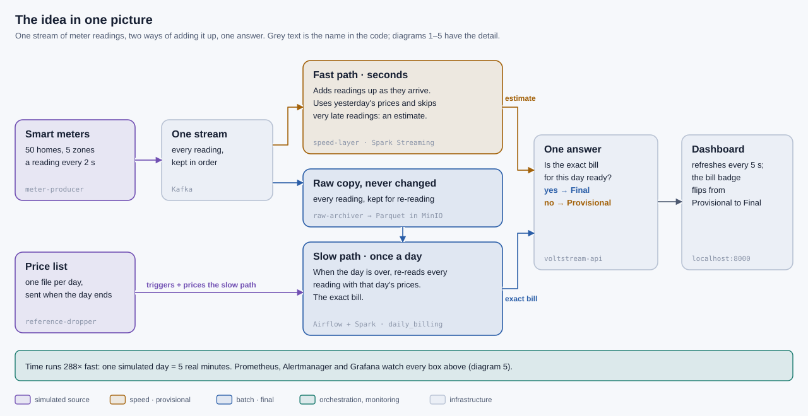
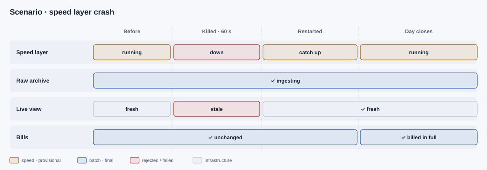
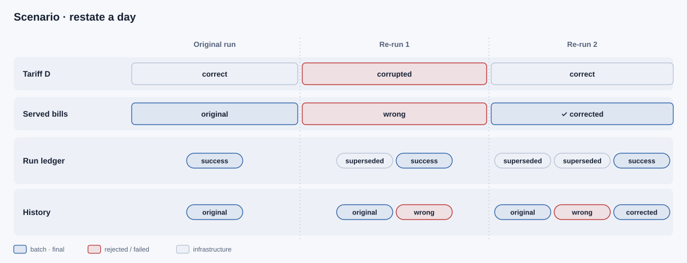
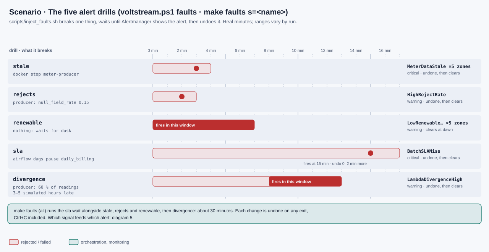
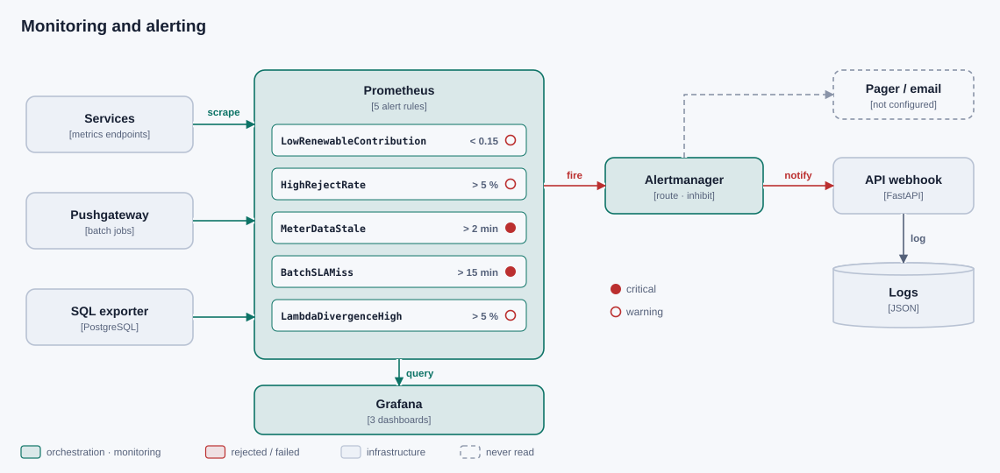

# ⚡ Voltstream

[](https://github.com/Malee-Fonseka/voltstream/actions/workflows/ci.yml)


**Real-time grid monitoring and exact daily billing from one smart-meter stream.**
A Lambda-architecture data platform built for _Smart Grid Energy Monitoring & Billing_.


<table>
<tr>
<td width="33%"><b>⚡ Live in seconds</b><br>Grid load and solar share per zone, about 6 s behind the meters.</td>
<td width="33%"><b>🧾 Exact bills, daily</b><br>The batch layer re-bills each closed day from the raw data with that day's tariff.</td>
<td width="33%"><b>🔔 Watched end to end</b><br>JSON logs, 10 metrics, 5 alert rules and 3 Grafana dashboards.</td>
</tr>
</table>

## Contents

1. [Architecture](#1-architecture)
2. [Quick start](#2-quick-start)
3. [The dashboard](#3-the-dashboard)
4. [Reproduce the results](#4-reproduce-the-results)
5. [Run the tests](#5-run-the-tests)
6. [Troubleshooting](#6-troubleshooting)
7. [Reference](#7-reference)

---

## 1. Architecture

Fifty simulated households report electricity use and rooftop solar every 2 seconds, and a
tariff file arrives once per simulated day. Two consumers need opposite things:

- **Grid operators** want load and renewable share per zone **within seconds**; an
  approximate answer now beats a perfect one later.
- **Billing** wants an **exact, auditable** bill per household per day, using that day's
  tariff and including late readings, which is only possible after the day closes.

A Lambda architecture serves both from one stream of readings: a fast path for "now", a slow
path for "exact", and one API that picks the better answer available.

<p align="center">
  <picture>
    <source media="(prefers-color-scheme: dark)" srcset="docs/architecture/diagrams/00-overview-dark.svg">
    
  </picture>
</p>

- The **speed layer** (Spark Structured Streaming) answers in seconds. It is deliberately
  approximate: it prices bills with yesterday's tariff and drops very late readings.
- The **batch layer** (Airflow + Spark) waits for the day to close, rescans the whole day
  from the immutable Parquet master dataset, applies that day's tariff and writes the final bill.
- The **API merges the two**: batch if the day is finalised, otherwise speed, and every
  response says which. The dashboard badge flips from **Provisional** to **Final**.
- **Reconciliation** explains the gap, split into a _tariff effect_ and a _data effect_.

Both layers import one shared billing module (`src/voltstream/core/`), and a consistency
test proves the pure-Python and Spark versions give identical bills.

**Simulated time:** one simulated day = **5 real minutes** (288× faster), starting at
2026-01-01 00:00 when the stack starts.

### How it works in detail

The picture above is all you need to run the project; the diagrams below are for reading the
code. They share one notation: **boxes** are services, **cylinders** are data stores, **pipes**
are Kafka topics, `[brackets]` give the technology, and **colour** gives the layer (amber =
speed, blue = batch, red = rejected or failed, dashed = never read).

**Containers and data flow.** The speed layer prices a day with the *previous* day's tariff
(`tariff D−1`); the batch layer waits for that day's own tariff (`tariff D`). Invalid readings
go to a rejects table and a dead-letter topic that nothing reads yet.

<p align="center">
  <picture>
    <source media="(prefers-color-scheme: dark)" srcset="docs/architecture/diagrams/01-data-flow-dark.svg">
    
  </picture>
</p>

### One simulated day

Steps 1–6 run all day: readings flow in, and a bill request gets the speed layer's estimate.
At simulated midnight the day's tariff lands (7); Airflow notices it (8), waits 90 s for late
readings (9), rescans the day and commits the bills with a `success` row (10–11), or marks the
run failed and retries (12). From then on the same request returns the final bill (14).

<p align="center">
  <picture>
    <source media="(prefers-color-scheme: dark)" srcset="docs/architecture/diagrams/02-day-sequence-dark.svg">
    
  </picture>
</p>

### The merge function

Every bill request goes through one decision: does `pipeline_runs` hold a `success` row for
this day? The ledger's states decide what the API serves, and why a final bill never reverts.

<p align="center">
  <picture>
    <source media="(prefers-color-scheme: dark)" srcset="docs/architecture/diagrams/03-bill-states-dark.svg">
    
  </picture>
</p>

### Bad, repeated and late readings

The producer injects six kinds of fault on purpose. The raw archiver keeps every record; each
layer then handles each fault differently, and the two differences that remain are exactly the
gap that reconciliation explains.

<p align="center">
  <picture>
    <source media="(prefers-color-scheme: dark)" srcset="docs/architecture/diagrams/04-fault-handling-dark.svg">
    
  </picture>
</p>

The diagrams are generated: edit `scripts/gen_diagrams.py` and run
`python scripts/gen_diagrams.py`, which writes both the light and dark versions.

### Deployment

Containers start in four health-gated tiers under Docker Compose. Tier 4 also runs the
Pushgateway, `sql-exporter` and a Docker socket proxy (18 containers in all).

<p align="center">
  
</p>

---

## 2. Quick start

**You need:** Docker Desktop with **at least 8 GB memory (10 GB recommended)** and 4+
CPUs, and Git (Git Bash on Windows). Ports 3000, 5432, 8000, 8011, 8012, 8080, 9000, 9001,
9090, 9091, 9093 and 29092 must be free.

```powershell
git clone https://github.com/Malee-Fonseka/voltstream.git
cd voltstream
.\scripts\voltstream.ps1 run        # Linux / WSL: make up
```

This builds the images, starts all 18 containers and waits for their health checks (first
build: several minutes; later starts: about a minute). `.env` is created from
`.env.example` automatically; nothing needs editing.

| What                      | URL                                                 | Login                                                          |
| ------------------------- | --------------------------------------------------- | -------------------------------------------------------------- |
| **Dashboard**             | <http://localhost:8000/>                            | none                                                           |
| API reference (OpenAPI)   | <http://localhost:8000/docs>                        | none                                                           |
| Grafana                   | <http://localhost:3000/>                            | none                                                           |
| Airflow                   | <http://localhost:8080/>                            | `admin`; password printed by `.\scripts\voltstream.ps1 status` |
| Prometheus / Alertmanager | <http://localhost:9090/> / <http://localhost:9093/> | none                                                           |
| MinIO console             | <http://localhost:9001/>                            | `voltstream` / `voltstream-dev`                                |

**What to expect:** live zone data within 20 s; day 1 billed about 8 minutes after start;
**day 2 (2026-01-02), the first complete day, billed and reconciled after about 13
minutes**. Then run `.\scripts\voltstream.ps1 check`; it should end with **0 failed**.
`LowRenewableContribution` firing every simulated night is expected (no sun).

| Windows                          | Linux / WSL                                                                | Effect                     |
| -------------------------------- | -------------------------------------------------------------------------- | -------------------------- |
| `.\scripts\voltstream.ps1 stop`  | `make down`                                                                | Stop, keep data            |
| `.\scripts\voltstream.ps1 start` | `docker compose --env-file .env -f docker/docker-compose.yml up -d --wait` | Resume on the same clock   |
| `.\scripts\voltstream.ps1 clean` | `make clean`                                                               | Delete containers and data |

<details>
<summary>Windows tips: giving Docker more memory, script permissions</summary>

Docker Desktop gets half the machine's RAM by default. For 10 GB, create
`C:\Users\<you>\.wslconfig` with:

```ini
[wsl2]
memory=10GB
```

then run `wsl --shutdown` and restart Docker Desktop. If PowerShell refuses to run the
script: `Set-ExecutionPolicy -Scope CurrentUser RemoteSigned`.

</details>

---

## 3. The dashboard

<http://localhost:8000/> refreshes every 5 seconds. Amber means speed layer / provisional,
teal means batch layer / final. Every chart has a table view (▦).

- **Live grid** (top of this page): load, solar, renewable share, active meters and
  speed-layer lag per zone, from 15-minute windows. Click a zone to focus on it.
- **Household bills**: one household's bill for one day, from whichever layer can answer,
  with the bill breakdown, energy flow, block tariff, estimate vs final and lineage.

| While the day is open: **Provisional (speed)**                          | After billing: **Final (batch)**                            |
| ----------------------------------------------------------------------- | ----------------------------------------------------------- |
|  |  |

- **Daily report**: everything known about one day: zone totals, rejected records by
  reason, speed-vs-batch divergence and every billing run.


- **How it works**: an animated pipeline diagram and a guided tour of one reading.

---

## 4. Reproduce the results

Each script runs unattended and **undoes its own changes**, even on Ctrl+C. Let at least one
day be billed first (about 8 minutes after start).

| Scenario              | Windows (`.\scripts\voltstream.ps1 …`)                                 | Linux                        | Shows                                                      | Time     |
| --------------------- | ---------------------------------------------------------------------- | ---------------------------- | ---------------------------------------------------------- | -------- |
| Provisional → final   | `demo`                                                                 | `make demo`                  | The merge function flipping a bill from speed to batch     | ~7 min   |
| All five alerts       | `faults`                                                               | `make faults`                | Each alert fires under its fault, then clears              | ~30 min  |
| One alert             | `faults -Scenario stale` (`rejects`, `sla`, `renewable`, `divergence`) | `make faults s=stale`        | A single alert                                             | 3–17 min |
| Crash the speed layer | `killtest`                                                             | `make kill-test`             | Losing the speed layer costs freshness, never correctness  | 7–10 min |
| Restate a day         | `backfill -Date 2026-01-02`                                            | `make backfill d=2026-01-02` | A corrupted tariff fixed by recomputing, with history kept | 6–8 min  |

What each scenario does, step by step, and what it checks (✓ marks the script's own checks):

### Provisional → final (`demo`)

The same household's bill for the same day, asked for before and after the day is billed.

<p align="center">
  <picture>
    <source media="(prefers-color-scheme: dark)" srcset="docs/architecture/diagrams/06-scenario-demo-dark.svg">
    
  </picture>
</p>

### Crash the speed layer (`killtest`)

<p align="center">
  <picture>
    <source media="(prefers-color-scheme: dark)" srcset="docs/architecture/diagrams/07-scenario-kill-dark.svg">
    
  </picture>
</p>

### Restate a day (`backfill`)

<p align="center">
  <picture>
    <source media="(prefers-color-scheme: dark)" srcset="docs/architecture/diagrams/08-scenario-restate-dark.svg">
    
  </picture>
</p>

### The five alert drills (`faults`)

Each drill breaks one thing, waits until Alertmanager shows the alert, then undoes it.

<p align="center">
  <picture>
    <source media="(prefers-color-scheme: dark)" srcset="docs/architecture/diagrams/09-scenario-drills-dark.svg">
    
  </picture>
</p>

Where each alert gets its data, and where it ends up:

<p align="center">
  <picture>
    <source media="(prefers-color-scheme: dark)" srcset="docs/architecture/diagrams/05-alerting-dark.svg">
    
  </picture>
</p>

| Alert                                | Fault                       | Fires after               |
| ------------------------------------ | --------------------------- | ------------------------- |
| `MeterDataStale` (critical)          | Meter producer stopped      | ~3 min                    |
| `HighRejectRate` (warning)           | 15% of readings invalid     | ~2 min                    |
| `BatchSLAMiss` (critical)            | Billing DAG paused          | 15 min after last billing |
| `LowRenewableContribution` (warning) | None: every simulated night | at dusk                   |
| `LambdaDivergenceHigh` (warning)     | 60% of readings very late   | 8–13 min (needs ~10 GB)   |

| Grafana: pipeline health                                                 | Prometheus: the five rules                                             |
| ------------------------------------------------------------------------ | ---------------------------------------------------------------------- |
|  |  |
| **Alertmanager**                                                         | **Grafana: Lambda divergence**                                         |
|                |  |

The batch layer in Airflow, `daily_billing`, with all eight tasks green:


**Query the API directly** (full reference at <http://localhost:8000/docs>; in PowerShell use `curl.exe`):

```bash
curl -s localhost:8000/api/v1/zones/load                                  # latest window per zone
curl -s "localhost:8000/api/v1/households/HH-0001/bill?date=2026-01-02"   # merged bill: see "source"
curl -s "localhost:8000/api/v1/reports/daily?date=2026-01-02"             # the daily report
```

---

## 5. Run the tests

Needs Python 3.11 and Java 17, not Docker:

```bash
python -m venv .venv                                   # Windows: py -3.11 -m venv .venv
.venv/bin/pip install -e ".[dev,api,sim,spark]"        # Windows: .venv\Scripts\pip ...
make test                                              # unit, property and consistency tests
```

`make coverage` adds CI's gate (`core/` at 100%), `make lint` runs ruff and mypy,
`make check-alerts` tests the alert rules with promtool, and `make test-all` adds the
integration tests (needs the stack running). CI runs lint, tests and alert checks on every
push.

---

## 6. Troubleshooting

| Symptom                                        | Fix                                                                                                   |
| ---------------------------------------------- | ----------------------------------------------------------------------------------------------------- |
| Start times out / a service is unhealthy       | `.\scripts\voltstream.ps1 status`, then `logs -Service <name>`. Usually Docker has too little memory  |
| Simulated dates far in the future              | The clock anchor in `.env` is stale: `clean`, then `run`. Never start with a bare `docker compose up` |
| After the laptop sleeps, `BatchSLAMiss` fires  | Expected (hours asleep are weeks simulated); clears after the next billing run                        |
| `check` fails during a billing run             | The laptop was briefly overloaded; re-run a minute later                                              |
| An alert in Grafana is missing in Alertmanager | It is inhibited by another alert; tick _Inhibited_                                                    |

---

## 7. Reference

| Service                                                                | Port                      | Role                                                                    |
| ---------------------------------------------------------------------- | ------------------------- | ----------------------------------------------------------------------- |
| `kafka`                                                                | 29092                     | Event log, 3 partitions, ~7 day retention                               |
| `postgres`                                                             | 5432                      | Serving layer: speed and batch views                                    |
| `minio`                                                                | 9000 / 9001               | Master dataset and landing zone (`pgsty/silo`, a MinIO-compatible fork) |
| `meter-producer`, `reference-dropper`                                  | —                         | The two simulated sources                                               |
| `raw-archiver`, `speed-layer`                                          | 8011, 8012                | Kafka → Parquet; live windows and provisional bills                     |
| `api`                                                                  | 8000                      | Serving API, merge function, dashboard                                  |
| `airflow` (+ `docker-socket-proxy`)                                    | 8080                      | Bills each day as its tariff lands                                      |
| `prometheus`, `alertmanager`, `pushgateway`, `sql-exporter`, `grafana` | 9090, 9093, 9091, —, 3000 | Monitoring and alerting                                                 |

| Looking for                                 | Start here                                                                                                            |
| ------------------------------------------- | --------------------------------------------------------------------------------------------------------------------- |
| Shared billing logic / layer agreement test | [src/voltstream/core/](src/voltstream/core/), [test_pure_vs_spark.py](tests/consistency/test_pure_vs_spark.py)        |
| Sources and ingestion                       | [simulators/](src/voltstream/simulators/), [streaming/](src/voltstream/streaming/)                                    |
| Batch layer                                 | [batch/](src/voltstream/batch/), [airflow/dags/](airflow/dags/)                                                       |
| Serving and the merge function              | [api/routers/households.py](src/voltstream/api/routers/households.py)                                                 |
| Observability                               | [metrics.py](src/voltstream/metrics.py), [config/prometheus/](config/prometheus/), [config/grafana/](config/grafana/) |

**Deliberately simplified:** 50 households, single-broker Kafka, single-node Spark, no
schema registry, secrets in `.env`. Time compression speeds up event time but not processing
time, so the live 15-minute view misses about 1% of energy that the batch layer still bills.
